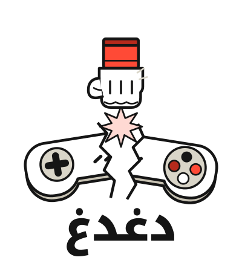

<p align="center"></p>

# دغدغ (Daghdagh)

Arabic-first (Egyptian dialect) party trivia game for friends: "العب، اتحدّى، دغدغ". Shipped as an installable, offline-capable Progressive Web App (PWA). Single-page, no build step, no backend to run.

**Live app:** https://ahmedsaeed515.github.io/daghdagh/

## Features

- 6,800+ questions across 40+ categories (flags, landmark and animal photos with credit lines, audio clips, Egyptian film casts and portraits, football nationality and career questions, date cards and emoji movies)
- Online game modes: classic race, bluff and imposter ("برا السرب"), all online only, each player on their own phone
- Teams mode (2 to 4 teams, team score = sum of members) for classic and bluff
- Name and bluff-answer word filter (`js/data/badwords.js`)
- Mixed difficulty on every question: easy 5, medium 10, hard 20 points
- Pick 10 to 30 questions per game; choose at least 6 categories to start
- Category browser with live search, filters and per-category question counts
- Room settings: number of rounds, max players, and host-approved joins
- Player profile: name and avatar only, saved on the device. No scores are stored
- Per-question timer, scoring, helpers (50/50, skip, double points)
- Online rooms: friends join from their own phones with a room code, a link or a QR code (nickname only)
- Host board: skip a question, end the game, remove a player
- Look: retro paper-and-ink style with one red accent and an animated controller logo
- Arabic (Egyptian dialect), right-to-left layout, mobile-first
- Installable (Add to Home Screen) and works offline after the first load
- Progress and settings stored locally on the device

## Quick start

No dependencies. Serve the folder with any static server (a service worker requires `http://localhost` or HTTPS):

```bash
git clone https://github.com/AhmedSaeed515/daghdagh.git
cd daghdagh
python3 -m http.server 8080
# open http://localhost:8080
```

## Project structure

| Path | Purpose |
| --- | --- |
| `index.html` | HTML shell that loads the styles and scripts |
| `manifest.json` | PWA manifest (name, RTL, theme, icons) |
| `js/data/` | Question banks (`questions/`), categories, flags and avatars |
| `js/lib/`, `js/online/`, `js/app/`, `js/main.js` | Helper classes, online rooms, views and game modes, boot |
| `sw.js` | Service worker: offline cache for the app shell |
| `css/base.css`, `css/theme.css` | Base styles, then the paper and ink theme |
| `assets/logo.svg` | Static logo used in the app header and this README (the home screen animates it inline) |
| `assets/icon.svg` | App icon |
| `docs/ARCHITECTURE.md` | How the app is built and how online rooms work |
| `docs/DEPLOYMENT.md` | Hosting on GitHub Pages and release steps |

## Deployment

Hosted on GitHub Pages from the `main` branch, root folder. Every push to `main` updates the live site within a couple of minutes. See [docs/DEPLOYMENT.md](docs/DEPLOYMENT.md).

## Documentation

- [Architecture](docs/ARCHITECTURE.md)
- [Deployment](docs/DEPLOYMENT.md)
- [Contributing](CONTRIBUTING.md)
- [Changelog](CHANGELOG.md)

## Privacy

The game has no accounts and no analytics. Settings and scores stay in the browser's `localStorage`. Online rooms relay small game messages through public ntfy topics, so do not type anything private into room names or player names. See the architecture notes.

## License

[MIT](LICENSE)

## Data sources and licensing

- Hand-written questions: original, written for this project.
- Wikidata facts (Egyptian film casts, football nationality and club careers) are CC0.
- Photos, portraits and audio come from Wikimedia Commons (public domain, CC0, CC BY and CC BY-SA only). Each photo shows its credit line in the game (`§P:url|credit§` rows in the question banks).
- No TMDB, no scraped datasets, no competitor content. Competitor games were used for mechanics and ideas only.
